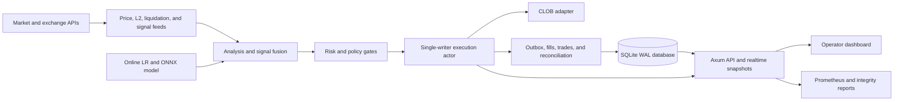

# Architecture

Macbot is a single-node async Rust service. Its central design goal is to keep trading mutations serialized while market data, research signals, persistence, and operator reads run concurrently.

## Runtime boundaries

### Control plane

`Config` is loaded from JSON, then constrained by environment overrides and runtime preflight checks. Updates prepare and validate a private candidate and persist it before publishing the new runtime state. Protected endpoints enforce the same credential requirements on localhost and remote connections. The service binds to loopback by default.

### Market and intelligence plane

Independent async tasks collect price, L2, liquidation, derivatives, order-flow, sentiment, temporal, and cross-market signals. Analysis combines available signals rather than assuming every source is healthy. Staleness is represented explicitly and can force no-trade behavior.

### Decision and risk plane

The fusion layer produces a directional probability and confidence breakdown. Policy gates then apply liquidity, spread, slippage, exposure, drawdown, time/session, regime, and strategy-specific constraints. Model output is an input to the decision path, not an authority that bypasses risk.

### Execution plane

An mpsc-backed actor serializes order and position mutations. Maker quote state includes cancel/replace pacing, drift, inventory skew, feed readiness, and quote telemetry. Funded taker and maker paths persist order identities before submission and account confirmed finalized receipts. A funded hybrid cross requires the actor to cancel all maker quotes, reconcile finalized fills, prove outstanding reservations resolved and refresh collateral before one taker submission; direct hybrid submissions are refused. Deliberate partial sales persist exact representable quantities and require finalized actual fills/fees before changing inventory. The binary imports the library modules, so unit tests and the executable compile one implementation.

Automatic entry work carries an explicit control generation. Stop or disabling automatic trading invalidates older work, and dispatch and final admission recheck the current controls; manual requests retain their separate provenance and still obey financial risk gates. Maker admission enforces percentage drawdown limits. A stopped or stale actor continues cancellation maintenance without needing another book update. Failed cancellations keep reservations and retry; order mode changes and shutdown also require cancellation and reconciliation of outstanding orders. Shutdown reports unresolved orders as well as positions, and a cancellation timeout does not prove an order is gone.

### Accounting and repair plane

SQLite stores trades, fills, rejections, idempotency records, outbox events, model inputs, analysis snapshots and standard collateral-adapter redemption receipts. Reconciliation compares exchange/local truth, repairs supported drift, and can force degraded no-trade or a kill switch. Startup and shutdown paths are designed to fail closed. Recurring settled maker/taker audits and guarded operator rechecks require the original complete history and finalized receipts; missing or changed evidence remains durable uncertainty. A separate stopped/frozen actor command can read and reconcile a supported externally submitted redemption, with exact managed-lot proof and atomic accounting; it signs or sends no transaction. HTTP start, unfreeze and configuration changes are excluded while that repair holds its control lease. Risk stops remain in place.

Daily loss, cash drawdown history and loss-streak sizing select the capital origin of the proposed order. Live wallet losses cannot be offset by simulation results; paper, shadow and simulation share the non-live accounting ledger. Daily dashboard evidence identifies its capital origin, while explicitly requested aggregate history reports can still combine research rows. A sale result requires confirmed exit SELL receipts for that lot and its realized accounting event; recovering an entry BUY cannot satisfy a close request.

### Operator and observability plane

Axum exposes health, readiness, preflight, risk, maker state, accounting truth, integrity, backtest, and history surfaces. SSE/WebSocket endpoints drive the dashboard. Prometheus rules and validation scripts turn runtime state into inspectable evidence.

## Persistence model

The database schema is created/migrated in code. WAL mode supports concurrent operator reads around a single logical writer. A kernel-held database inode lease prevents two cooperating service instances from owning the same file, including path aliases; descriptor close or process crash releases it. This is a local single-instance contract, not distributed locking or protection against replacing an active file. Generated databases are runtime artifacts and are not source-controlled.

The ONNX file at `models/latest.onnx` is a reproducible, untrained runtime fixture in the source snapshot, identified by `models/provenance.json`. It has no learned trading edge. Online weights and ensemble state are runtime-specific and ignored.

## Failure posture

- Stale or missing critical market data can block entries.
- Backpressure and task failures are surfaced through metrics/readiness.
- Reconciliation drift can force degraded no-trade and the kill switch.
- Live preflight blocks automatic loop start when required controls are not ready.
- The service does not claim fault tolerance across multiple nodes; SQLite and the in-memory actor define a single-instance ownership model.
